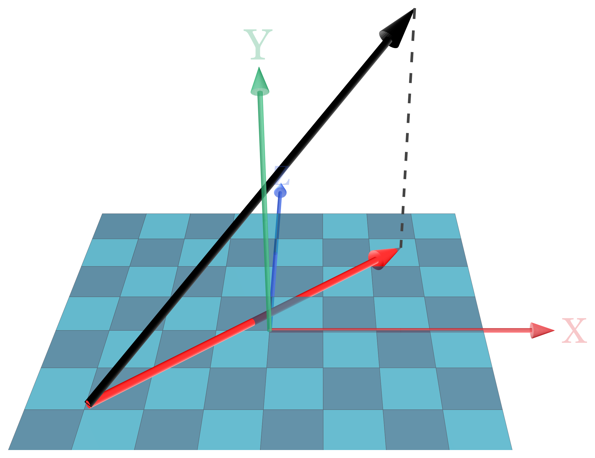
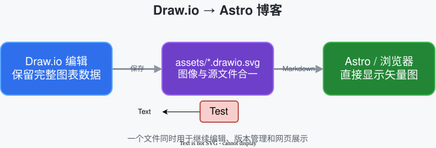

这一页是系统的写作样例，用来确认排版、代码、公式和媒体的渲染结果。

## 基本使用

### 标题

用 `#` 到 `######` 分级。标题会自动进入左侧目录，父级可折叠。

### 字体控制

**加粗**、*斜体*、***加粗斜体***、~~删除线~~、`行内代码`。

### 代码

行内代码写 `npm run build` 这样。

代码块标注语言后带语法高亮：

```ts
const posts = await getCollection('docs');
return posts.filter((entry) => entry.id.startsWith('posts/'));
```

### 插入图片

Markdown 图片语法，构建时会优化成 WebP 并补上宽高：

```markdown

```


### 标记段

引用：

> 坐标只是描述，不是物体本身。

列表：

- 无序列表项
- 可以嵌套
  - 第二层

1. 有序列表第一项
2. 第二项

表格：

| 字段 | 说明 |
| --- | --- |
| `title` | 必填 |
| `date` | `YYYY-MM-DD` |
| `category` | 一级分类，只有一个 |

行内公式 $a' = R^{T}a$，块级公式：

$$
y(t) = y_0 + v_{y0}t - \frac{1}{2}gt^{2}
$$

## Manim

### 视频

```html
<video controls playsinline preload="metadata" poster="/media/<slug>/name-poster.webp">
  <source src="/media/<slug>/name.webm" type="video/webm" />
  <source src="/media/<slug>/name.mp4" type="video/mp4" />
</video>
```

<video controls playsinline preload="metadata" poster="/media/blog-writing-sample/bouncing-ball-poster.webp" style="width:100%;border-radius:4px">
  <source src="/media/blog-writing-sample/bouncing-ball.webm" type="video/webm" />
  <source src="/media/blog-writing-sample/bouncing-ball.mp4" type="video/mp4" />
  Your browser does not support embedded video.
</video>

### 3D 图片

场景只调用 `self.add(...)`、没有动画时，用 still 模式直接出图：

```bash
node scripts/render-manim.mjs --mode still --scene-file scenes/vec3_project.py
```

产物是裁过白边的 PNG，放在文章自己的 `assets/` 里，用相对路径引用：



## Draw.io

Draw.io 可以把完整图表数据嵌入 SVG。产物既是浏览器可以直接显示的矢量图，也能重新用 Draw.io 打开继续编辑，不需要额外维护源文件和导出图片。

在 Draw.io 中选择 **File → Save As → Editable Vector Image (.svg)**，或导出 SVG 时勾选 **Include a copy of my diagram**，然后把文件保存到文章自己的 `assets/` 目录。文件名推荐保留 `.drawio.svg` 后缀：

```text
src/content/docs/posts/<slug>/assets/<name>.drawio.svg
```

Markdown 仍然使用标准图片语法，不需要定制插件：

```markdown

```


当前示例源文件与网页图片是同一个文件：`assets/drawio-workflow.drawio.svg`。重新用 Draw.io 打开并保存它，文章中的图会随之更新。

Draw.io 会把较长的编辑数据放进 SVG 根标签，而 Astro 只扫描文件开头来读取图片尺寸。项目会在 `dev`、`check` 和 `build` 前自动执行 `npm run drawio:prepare`，补充 Astro 所需的尺寸提示；因此保存后可以直接运行正常命令，不需要手工修改 SVG。
