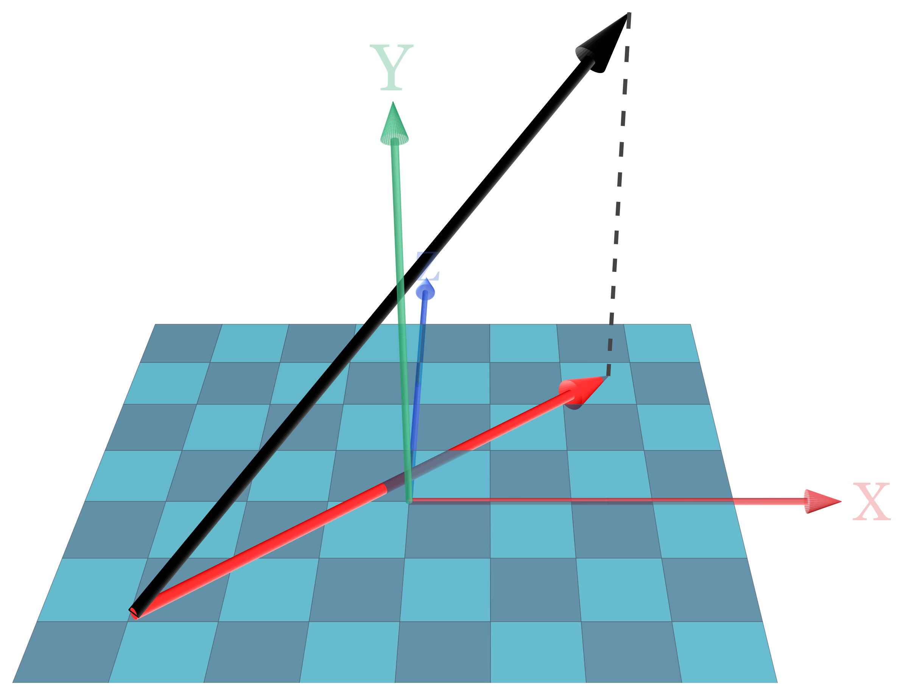
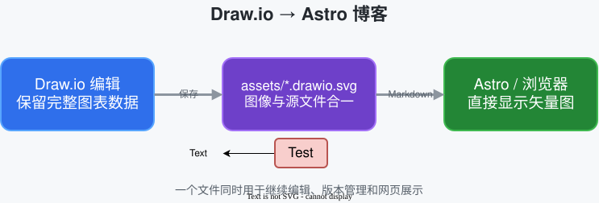
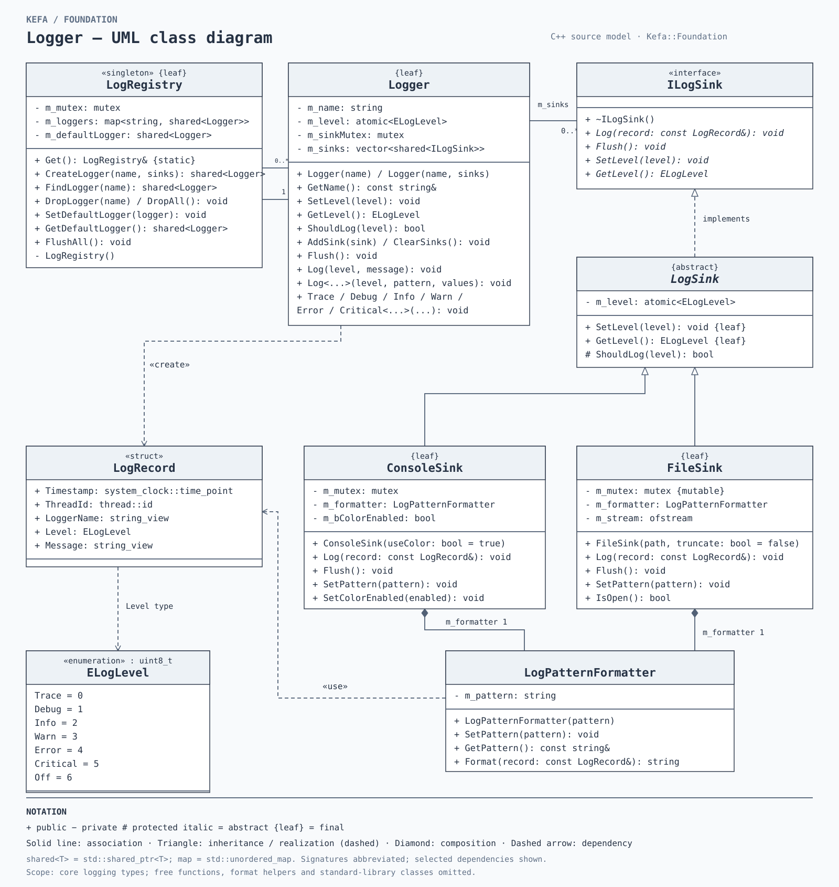
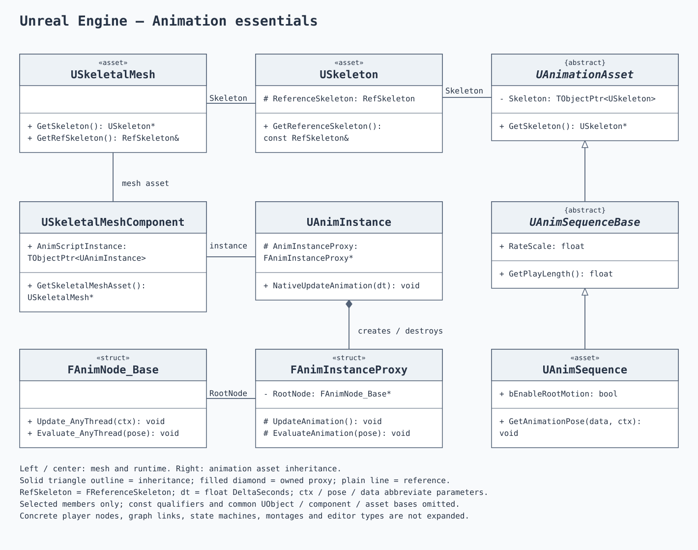
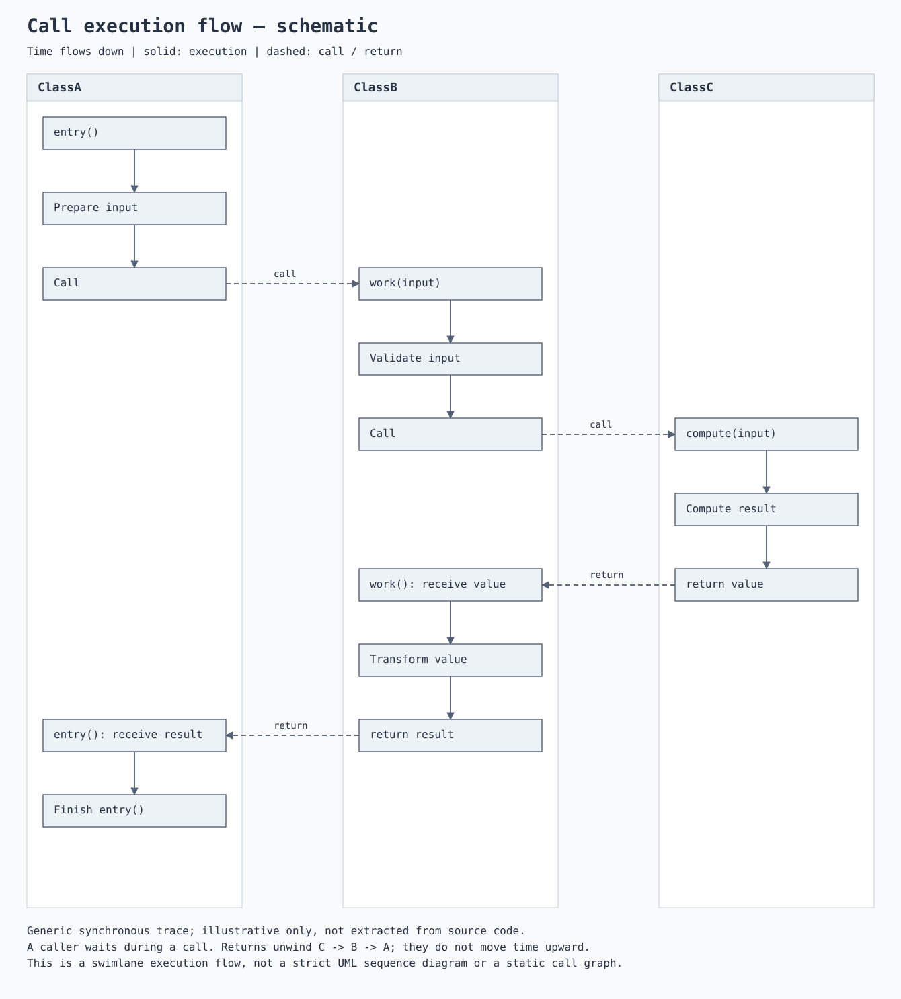

这一页是系统的写作样例，用来确认排版、代码、公式和媒体的渲染结果。

## 基本使用

### 标题

用 `#` 到 `######` 分级。标题会自动进入左侧目录，父级可折叠。

### 字体控制

**加粗**、*斜体*、***加粗斜体***、~~删除线~~、`行内代码`。

### 代码

行内代码写 `npm run build` 这样。

代码块标注语言后带语法高亮：

```ts
const posts = await getCollection('docs');
return posts.filter((entry) => entry.id.startsWith('posts/'));
```

### 插入图片

Markdown 图片语法，构建时会优化成 WebP 并补上宽高：

```markdown

```


### 标记段

引用：

> 坐标只是描述，不是物体本身。

列表：

- 无序列表项
- 可以嵌套
  - 第二层

1. 有序列表第一项
2. 第二项

表格：

| 字段 | 说明 |
| --- | --- |
| `title` | 必填 |
| `date` | `YYYY-MM-DD` |
| `category` | 一级分类，只有一个 |

行内公式 $a' = R^{T}a$，块级公式：

$$
y(t) = y_0 + v_{y0}t - \frac{1}{2}gt^{2}
$$

## Manim

### 视频

```html
<video controls playsinline preload="metadata" poster="/media/<slug>/name-poster.webp">
  <source src="/media/<slug>/name.webm" type="video/webm" />
  <source src="/media/<slug>/name.mp4" type="video/mp4" />
</video>
```

<video controls playsinline preload="metadata" poster="/media/blog-writing-sample/bouncing-ball-poster.webp" style="width:100%;border-radius:4px">
  <source src="/media/blog-writing-sample/bouncing-ball.webm" type="video/webm" />
  <source src="/media/blog-writing-sample/bouncing-ball.mp4" type="video/mp4" />
  Your browser does not support embedded video.
</video>

### 3D 图片

场景只调用 `self.add(...)`、没有动画时，用 still 模式直接出图：

```bash
node scripts/render-manim.mjs --mode still --scene-file scenes/vec3_project.py
```

产物是裁过白边的 PNG，放在文章自己的 `assets/` 里，用相对路径引用：



## Draw.io

Draw.io 可以把完整图表数据嵌入 SVG。产物既是浏览器可以直接显示的矢量图，也能重新用 Draw.io 打开继续编辑，不需要额外维护源文件和导出图片。

在 Draw.io 中选择 **File → Save As → Editable Vector Image (.svg)**，或导出 SVG 时勾选 **Include a copy of my diagram**，然后把文件保存到文章自己的 `assets/` 目录。文件名推荐保留 `.drawio.svg` 后缀：

```text
src/content/docs/posts/<slug>/assets/<name>.drawio.svg
```

Markdown 仍然使用标准图片语法，不需要定制插件：

```markdown

```


当前示例源文件与网页图片是同一个文件：`assets/drawio-workflow.drawio.svg`。重新用 Draw.io 打开并保存它，文章中的图会随之更新。

Draw.io 会把较长的编辑数据放进 SVG 根标签，而 Astro 只扫描文件开头来读取图片尺寸。项目会在 `dev`、`check` 和 `build` 前自动执行 `npm run drawio:prepare`，补充 Astro 所需的尺寸提示；因此保存后可以直接运行正常命令，不需要手工修改 SVG。

### 类图

#### Logger
下面的 UML 类图依据 `Kefa/engine/foundation` 的 C++ logger 头文件与实现绘制，展示核心类型、成员和主要关系；模板方法与部分签名作了简写，自由函数和标准库类型未展开。



- **接口实现与继承**：虚线空心三角表示 `LogSink` 实现 `ILogSink`；实线空心三角表示两个具体 sink 继承抽象类 `LogSink`。
- **关联与组合**：`LogRegistry` → `Logger`、`Logger` → `ILogSink` 是 `shared_ptr` 持有的关联，不表示独占生命周期；sink → `LogPatternFormatter` 是按值成员形成的组合，实心菱形位于 sink 一端。
- **依赖**：`Logger` 创建 `LogRecord`，formatter 读取它；`LogRecord::Level` 使用 `ELogLevel`。图中只展开主要依赖，不穷举每个参数类型。
- **可见性**：`+` / `-` / `#` 分别表示 public / private / protected；斜体表示抽象类或纯虚方法，`{leaf}` 对应 C++ `final`。

图源与展示图片均为 `assets/kefa-logger.drawio.svg`，可用 Draw.io 重新打开编。`LogRecord` 的字符串字段是 `string_view`，并不拥有文本；当前实现同步分发记录，不能据此推断为异步日志系统。

#### UE

下面依据本地 Unreal Engine 源码，选取 **9 个基础类型**，只展示动画资产与运行时入口的主要关系，不展开整个动画系统。核心声明位于 `Engine/Source/Runtime/Engine/Classes/Animation/`；Proxy 位于 `Public/Animation/`，Mesh 和 Component 分别位于 `Classes/Engine/` 与 `Classes/Components/`。



### 泳道式调用执行流

这类图可以称为 **泳道式调用执行流图**：每条泳道代表一个类或对象，时间从上往下走。它借用了时序图的参与者布局，但用纵向实线箭头展示执行步骤，因此不是严格的 UML 时序图，也不是只展示函数依赖的静态调用图。



- **纵向实线箭头**：当前泳道继续执行，时间始终向下。
- **跨泳道虚线箭头**：`call` 进入被调函数，`return` 回到调用者的续执行点；返回不是向上倒退。
- **嵌套调用**：A → B → C 后，必须先 C → B，再 B → A。调用者等待时不画继续执行的箭头，避免暗示并行执行。

这是使用 `ClassA` / `ClassB` / `ClassC` 的抽象示意，不对应具体代码，只表达一条同步执行路径。图源为 `assets/call-flow.drawio.svg`，可用 Draw.io 二次编辑；通用生成模型与规则位于 `.pi/skills/graph-generator/`。
