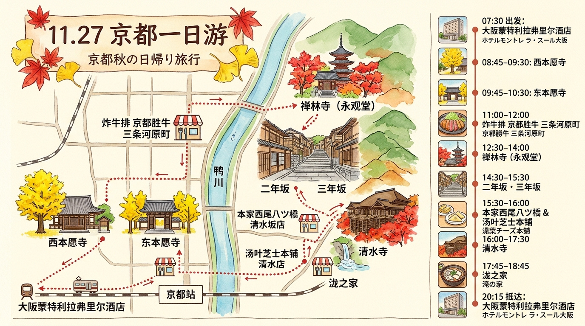

11.27 京都一日游
大阪蒙特利拉弗里尔酒店出发
西本愿寺  （银杏）
东本愿寺（银杏）
炸牛排 京都胜牛 三条河原町
禅林寺 (永観堂)
二年坂
三年坂
Honke Nishio Yatsuhashi Kiyomizuzaka Store
湯葉チーズ本舗 清水店
清水寺
Takinoya
大阪蒙特利拉弗里尔酒店出发

> 请基于googlemap真实比例尺绘制地图背景，生成手账风格的路线图。地图上需要标注地点名和地标插画图（餐厅只需标注名字+统一餐厅插画），地名只需要单标题，如有中文尽量中文，必须按照真实地图的位置坐标生成，可以比例尺不一致，但相对位置需要符合真实位置。侧边列出我给出地点的地标图片/餐厅的招牌美食图片，并标出每个地点大致的到达-离开时间。侧边列地名如果可以请标注中/日双语，中文主标题，日文副标题小字，如中日文相同可省略副标题。 图片文字需清晰正确

